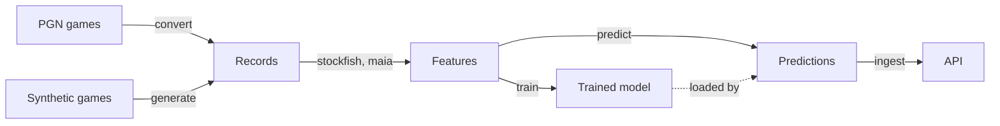

# Blunder

Cheat detection for online chess.

## Overview



- **Records** are JSONL, one game per line, with its moves, features and predictions.
- **Features** come from Stockfish and Maia.
- **Predictions** give the probability that each move was engine-assisted.
- **Outcomes** are `neither`, `white`, `black` or `both`.

## Layout

| Package                            | Purpose                                              |
| ---------------------------------- | ---------------------------------------------------- |
| [`apps/ingestion`](apps/ingestion) | Converts PGN to records, loads records into the API. |
| [`apps/analysis`](apps/analysis)   | Runs the feature, train and predict pipeline.        |
| [`apps/synthetic`](apps/synthetic) | Generates labelled games with selective cheaters.    |
| [`apps/api`](apps/api)             | Stores games, features and predictions in Postgres.  |
| [`libs/shared`](libs/shared)       | Records, data models and configs.                    |
| [`libs/maia`](libs/maia)           | Maia features and move sampling.                     |
| [`libs/stockfish`](libs/stockfish) | Stockfish features and regret.                       |
| `libs/client`                      | API client, generated when the workspace is built.   |

## Setup

You need Python 3.15, [uv](https://docs.astral.sh/uv/) and a `stockfish` binary on your `PATH`.

```sh
uv sync --all-packages
cp .env.example .env
docker compose up -d
cd apps/api
uv run alembic upgrade head
uv run api
```

## Usage

Run from the repository root, with the API running.

```sh
# Generate synthetic games with selective cheaters
uv run generate storage/example/synthetic.yml storage/synthetic.jsonl --limit 100

# Extract features from the games and train a model on them
uv run analyse storage/example/train.yml storage/synthetic.jsonl storage/trained.jsonl

# Convert a PGN game to records
uv run convert storage/example/game.pgn storage/game.jsonl

# Extract features from the game and predict with the trained model
uv run analyse storage/example/predict.yml storage/game.jsonl storage/predicted.jsonl

# Ingest the predicted game into the API
uv run ingest storage/predicted.jsonl
```

## Development

Always pass `--all-packages` when syncing, because a plain `uv sync` removes the workspace packages.
After an API schema change, regenerate the client:

```sh
uv sync --all-packages --reinstall-package blunder-client
```

Check the code:

```sh
ruff format
ruff check
ty check
```
